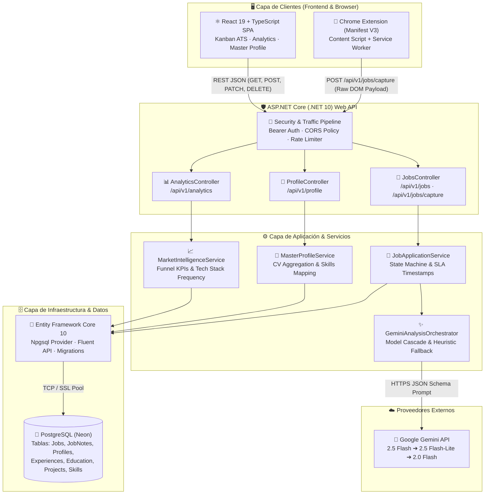
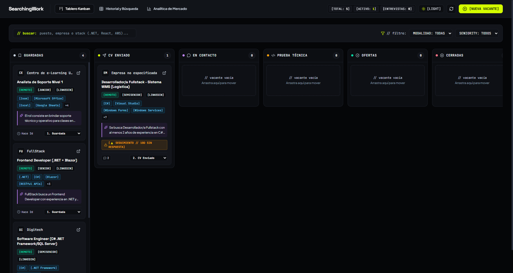
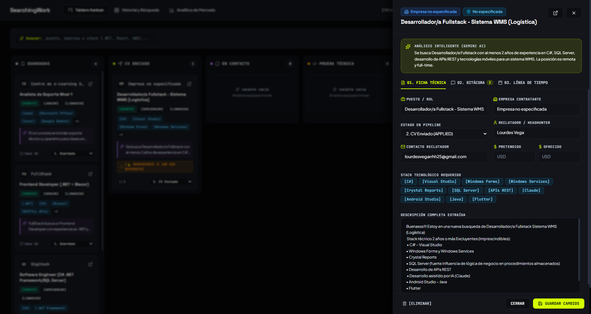
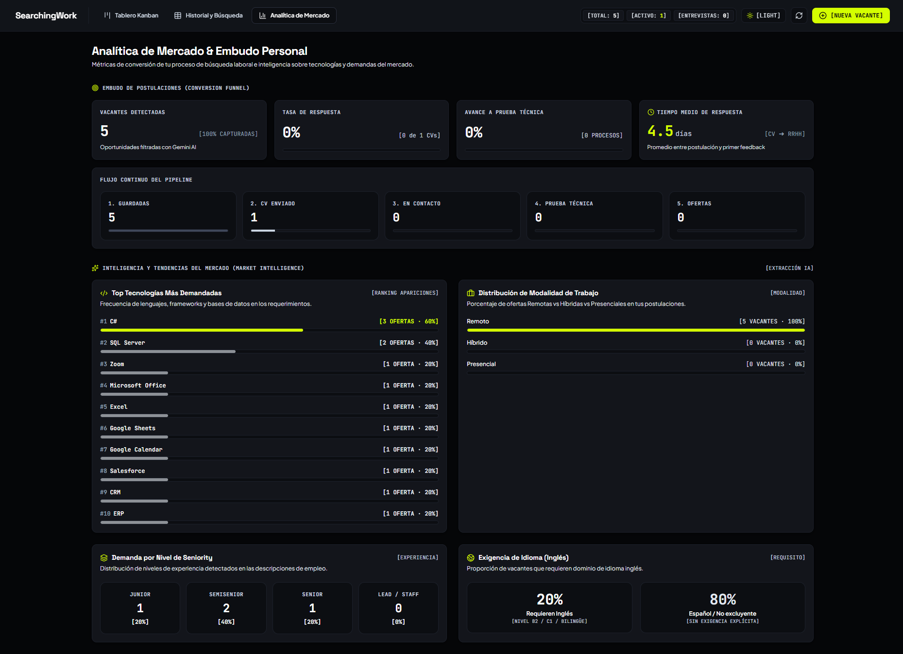
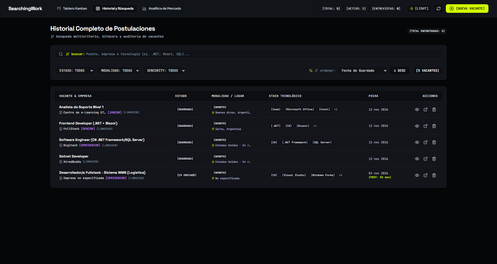
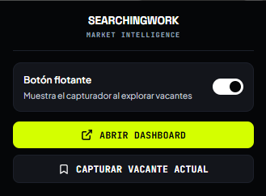
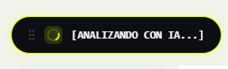

# 🎯 SearchingWork — Personal ATS, Career Hub & AI Market Intelligence

> **Plataforma SaaS de gestión del ciclo de vida de postulaciones técnicas, extracción semántica de vacantes mediante IA generativa y analítica de mercado laboral en tiempo real.**

[-4169E1?style=for-the-badge&logo=postgresql&logoColor=white)](https://www.postgresql.org/)

---

> [!IMPORTANT]
> **🔒 Aviso de Propiedad Intelectual y Estado de Migración Arquitectónica**
> 1. **Repositorio Showcase (Vitrina Técnica):** Por tratarse de un producto SaaS propietario en evolución, el código fuente de producción se mantiene en un repositorio privado. Este repositorio público expone exclusivamente el diseño de arquitectura, contratos de dominio, decisiones técnicas y demostraciones visuales del sistema.
> 2. **Migración Activa a .NET 10:** El MVP funcional fue inicialmente prototipado y validado sobre Next.js y PostgreSQL. Actualmente, el núcleo transaccional y de servicios se encuentra en **migración activa hacia una arquitectura empresarial en ASP.NET Core (.NET 10) Web API, Entity Framework Core y PostgreSQL**, manteniendo el ecosistema cliente en **React + TypeScript** y la **Extensión de Chrome (Manifest V3)**. Toda la documentación técnica de este documento refleja dicha arquitectura objetivo.

---

## 📌 1. El Problema y la Solución

### El Problema
Los profesionales de tecnología que gestionan procesos de selección activos enfrentan una alta fragmentación de datos:
* Ofertas distribuidas entre **LinkedIn Jobs**, publicaciones informales en el **Feed de reclutadores** y portales externos (Bumeran, Computrabajo, Indeed).
* Pérdida de trazabilidad sobre el estado de cada proceso, fechas de contacto, tiempos de respuesta (SLA de reclutamiento), expectativas salariales negociadas y feedback de entrevistas técnicas.
* Descripciones de puesto extensas, desestructuradas o con ruido visual que dificultan identificar rápidamente el stack real, requerimiento de idioma, modalidad y seniority, así como la falta de métricas reales sobre qué tecnologías demanda el mercado.

### La Solución
**SearchingWork** centraliza la captura, normalización y seguimiento analítico de oportunidades laborales en un flujo de tres etapas sin fricción:

1. **Captura Contextual en 1 Clic (Chrome Extension MV3):** Mientras el usuario navega en una vacante formal o en un post de reclutador en LinkedIn, un widget inyectado extrae el DOM relevante mediante selectores defensivos (y limpieza de ruido/comentarios) y despacha la carga cruda al backend.
2. **Enriquecimiento Semántico con IA (Server-Side Gemini Pipeline):** La Web API en **ASP.NET Core (.NET 10)** procesa el texto no estructurado a través de una cascada tolerante a fallos de modelos **Google Gemini**, extrayendo un contrato JSON tipado con: puesto normalizado, empresa contratante (diferenciándola de la consultora/reclutador en posts), seniority, modalidad, nivel de inglés, array de tecnologías (`stack`), rango salarial y resumen ejecutivo de 2 oraciones.
3. **Gestión ATS, Perfil Maestro y Analítica de Mercado (React SPA):** La vacante ingresa automáticamente al pipeline Kanban (`WISHLIST` ➔ `APPLIED` ➔ `IN_CONTACT` ➔ `TECHNICAL_TEST` ➔ `OFFER` / `REJECTED`), activando máquinas de estados con sellado cronológico automático, alertas de inactividad (`> 7 días` sin respuesta), bitácora de notas, gestión de **Perfil Maestro (CV Hub)** y un motor de **Market Intelligence** que calcula tasas de conversión de embudo y ranking de tecnologías más demandadas.

---

## 🏗️ 2. Arquitectura Técnica y Flujo de Datos (.NET 10 Target Architecture)

El sistema implementa los principios de **Clean Architecture** sobre **ASP.NET Core (.NET 10)**, separando estrictamente los adaptadores de captura (Extensión MV3 y SPA en React), la lógica de negocio y orquestación de IA (Application Layer), las entidades y reglas de estado (Domain Layer) y la persistencia relacional con **Entity Framework Core + Npgsql** sobre **PostgreSQL (Neon Serverless)**.

### Diagrama de Arquitectura y Secuencia de Captura

---

### Modelo Relacional de Dominio (EF Core Entities)

El esquema en **PostgreSQL** aprovecha tipos nativos avanzados (`uuid`, `text[]` para indexación de tecnologías y `timestamptz` para trazabilidad horaria) modelados en EF Core:

| Entidad Principal | Responsabilidad en el Dominio | Relaciones y Características Clave |
| :--- | :--- | :--- |
| **`Job`** | Vacante capturada y estado actual del proceso en el pipeline ATS. | Clave `UUID`, array nativo `Stack (text[])`, enumeradores de `Status`, `Seniority`, `Modality`, `Source` (`linkedin_job`, `linkedin_post`, `manual`), `Portal`, métricas salariales (`numeric(12,2)`) y 5 hitos `timestamptz` (`CreatedAt`, `AppliedAt`, `ContactedAt`, `TechnicalInterviewAt`, `ClosedAt`). Índices B-Tree compuestos por estado, modalidad y fecha. |
| **`JobNote`** | Bitácora cronológica de eventos, feedback de entrevistas y seguimiento por vacante. | Relación `1:N` con `Job` (`OnDelete: Cascade`). Indexado por `JobId` y `CreatedAt DESC`. |
| **`Profile`** | Cabecera del **Perfil Maestro** del candidato (base para generación de CV adaptativo). | Almacena datos de contacto, bio ejecutiva, enlaces profesionales y coordina 4 agregados hijos en cascada. |
| **`ProfileExperience`** | Historial de experiencia laboral y logros cuantificables. | Relación `1:N` con `Profile`, incluye array `Technologies (text[])` y flag `IsCurrent`. |
| **`ProfileEducation`** | Formación académica, certificaciones e insignias verificables. | Clasificación por tipo (`degree`, `certification`, `course`) y URLs de credencial. |
| **`ProfileProject`** | Portfolio técnico de proyectos y despliegues en vivo. | Almacena stack aplicado, URL de repositorio y demo productiva. |
| **`ProfileSkill`** | Matriz categorizada de habilidades técnicas y blandas. | Agrupación por `Category` (`Languages`, `Frameworks`, `Databases`, `Tools`, `SoftSkills`) y nivel de dominio. |

---

## ⚡ 3. Características Técnicas Destacadas

### 1. Orquestación de IA con Cascada Tolerante a Fallos y Fallback Heurístico
Para garantizar **alta disponibilidad (Zero-Data-Loss)** al capturar una oferta desde el navegador —incluso ante picos de latencia o límites de cuota (`429 Too Many Requests` / RPD) en la API de Google—, el servicio de IA implementa el patrón **Chain of Responsibility / Fallback Cascade**:
* **Cascada de Modelos:** Intenta la extracción estructurada iterando en orden de eficiencia y cuota diaria: `gemini-2.5-flash` ➔ `gemini-2.5-flash-lite` ➔ `gemini-2.0-flash`.
* **Prompts Contextuales Duales:** Distingue automáticamente entre una oferta estructurada (`linkedin_job`) y una publicación orgánica de reclutador (`linkedin_post`). En los posts, limpia marcadores residuales de la interfaz de LinkedIn y aplica reglas de inferencia para no confundir el nombre del reclutador/consultora con la empresa cliente final.
* **Degradación Elegante (Heuristic Fallback):** Si todos los modelos externos fallan o hay un corte de red, el sistema conmuta a un analizador determinista local que sanitiza títulos, ubicaciones y descripciones, asegurando que la vacante se persista siempre en la base de datos con código `201 Created`.

### 2. Scraper Defensivo Multi-Prioridad en Chrome Extension (Manifest V3)
LinkedIn modifica y ofusca periódicamente sus clases CSS mediante hashes dinámicos. El `content.js` de la extensión evita roturas mediante una arquitectura de **extracción por capas de prioridad**:
* **Ofertas de Empleo (`linkedin_job`):** Evalúa en orden: enlaces estructurales canónicos (`a[href*="/jobs/view/"]`), atributos de accesibilidad estables (`aria-label^="Empresa,"`), selectores semánticos de cabecera, ítem activo del listado lateral y metadatos OpenGraph (`og:title`).
* **Publicaciones en el Feed (`linkedin_post`):** Utiliza exclusivamente anclas inmutables (`data-testid="expandable-text-box"`), expande programáticamente el truncamiento (`...más`) antes de leer el DOM, aísla el cuerpo del post excluyendo nodos posteriores al primer comentario mediante `Node.compareDocumentPosition`, y extrae automáticamente el correo (`mailto:` / regex) o perfil del reclutador.
* **Enrutamiento Inteligente Zero-Config (`background.js`):** El Service Worker detecta mediante *health-check* con `AbortController` (timeout de 2.5s) si el entorno de desarrollo local está activo o si debe enrutar el tráfico directamente hacia el clúster de producción.

### 3. Máquina de Estados Cronológica y Detección de Ghosting (SLA > 7 Días)
El servicio de dominio de vacantes (`JobApplicationService`) gobierna las transiciones de estado e inyecta sellos de tiempo inmutables sin intervención manual del usuario:
* Transición a `APPLIED` $\rightarrow$ Sella `AppliedAt = DateTimeOffset.UtcNow` (si era nulo).
* Transición a `IN_CONTACT` $\rightarrow$ Sella `ContactedAt = DateTimeOffset.UtcNow`.
* Transición a `TECHNICAL_TEST` $\rightarrow$ Sella `TechnicalInterviewAt = DateTimeOffset.UtcNow`.
* Transición a `OFFER` o `REJECTED` $\rightarrow$ Sella `ClosedAt = DateTimeOffset.UtcNow`.
* **Cálculo de SLA y Alertas:** El motor analítico mide la delta $(\text{ContactedAt} - \text{AppliedAt})$ para calcular la velocidad media de respuesta del mercado en días y dispara alertas visuales automáticas en las tarjetas que superan los **7 días corridos** en estado `APPLIED` sin novedades (`[⚠️ SEGUIMIENTO REQUERIDO]`).

### 4. Seguridad, Protección de Secretos y Políticas de Tráfico
* **Aislamiento de Credenciales (Server-Side Secret Management):** La clave `GEMINI_API_KEY` y las cadenas de conexión a PostgreSQL residen estrictamente en el servidor (variables de entorno seguras / Secret Manager). La extensión de Chrome jamás almacena ni expone claves de proveedores de IA en el cliente.
* **Autenticación Bearer y CORS Defensivo:** Los endpoints de mutación e ingesta validan tokens de autorización (`Authorization: Bearer <APP_API_SECRET>`) y aplican políticas CORS restrictivas y `Rate Limiting` en el pipeline de ASP.NET Core para prevenir abusos de cuota de IA.
* **Sanitización de Entrada y Salida:** Validación estricta de contratos DTO, descarte de banners basura del DOM mediante listas negras léxicas y normalización forzada a esquemas JSON (`responseMimeType: "application/json"` con `temperature: 0.1`).

### 5. Sistema de Diseño Propio ("SearchingWork Pro")
La interfaz de usuario en React sigue una especificación de diseño industrial propia documentada al detalle:
* **Dualidad Tonal / Obsidiana:** Modo Claro inspirado en *Google Workspace / Stripe* (`#F6F8FC`) y Modo Oscuro de alto contraste en Negro Obsidiana (`#050608`) con acento técnico en **Laser Volt (`#D4FF00`)** y bloques de análisis de IA en **Gemini Lavanda**.
* **Tríada Tipográfica Funcional:** `Space Grotesk` para titulares arquitectónicos, `JetBrains Mono` para metadatos técnicos, salarios y badges mecánicos (`[REMOTE]`, `[SENIOR]`, `[$4.5K]`), y `Plus Jakarta Sans` para lectura prolongada.

---

## 📸 4. Demostración Visual y Producto en Vivo

🔗 **Demo / Landing Page & Video Walkthrough:** [https://www.sebastianduarte.com/searchingwork](https://www.sebastianduarte.com/searchingwork)

### Tablero Kanban ATS & Pipeline de Postulaciones
> *Vista principal con columnas tonales Drag & Drop, chips mecánicos en monoespaciada, resumen ejecutivo generado por Gemini IA y alertas de seguimiento (>7 días).*

### Panel de Inspección Técnica, Bitácora y Línea de Tiempo (Drawer)
> *Inspección detallada de la oferta, datos de contacto del reclutador, expectativas salariales, bitácora de entrevistas y trazabilidad de hitos cronológicos.*

### Market Intelligence & Métricas de Embudo Personal
> *Analítica en tiempo real: tasas de conversión (Aplicación ➔ Contacto ➔ Prueba Técnica ➔ Oferta), tiempo promedio de respuesta, distribución de modalidades, exigencia de inglés y ranking de las 10 tecnologías más solicitadas en las búsquedas del usuario.*

### Historial Completo y Búsqueda Multicriterio
> *Tabla de auditoría técnica con filtrado combinado por estado, modalidad, seniority y búsqueda libre por tecnologías o empresa.*

### Capturador Contextual en LinkedIn (Chrome Extension MV3)
> *Panel de control de la extensión y secuencia interactiva en 3 estados del botón flotante inyectado en LinkedIn (Reposo ➔ Extracción & Análisis con Gemini IA ➔ Confirmación de Persistencia).*

| 1️⃣ Estado en Reposo (Listo para Capturar) | 2️⃣ Procesamiento Semántico con Gemini IA | 3️⃣ Vacante Persistida en el Tablero ATS |
| :---: | :---: | :---: |
|  |  |  |

---

## 👨‍💻 5. Autor y Contacto

Desarrollado y arquitecturado por **Sebastián Duarte**  
*Backend .NET & AI Solutions Architect*

* 🌐 **Sitio Web & Portfolio:** [https://www.sebastianduarte.com/searchingwork](https://www.sebastianduarte.com/searchingwork)
* 💼 **LinkedIn:** [https://www.linkedin.com/in/sebastiandte](https://www.linkedin.com/in/sebastiandte)
* ✉️ **Correo Electrónico:** [contacto@sebastianduarte.com](mailto:contacto@sebastianduarte.com)
* 🐙 **GitHub:** [@SebastianDte](https://github.com/SebastianDte)

---
*© 2026 Sebastián Duarte — Todos los derechos reservados. Documentación de arquitectura para repositorio Showcase.*